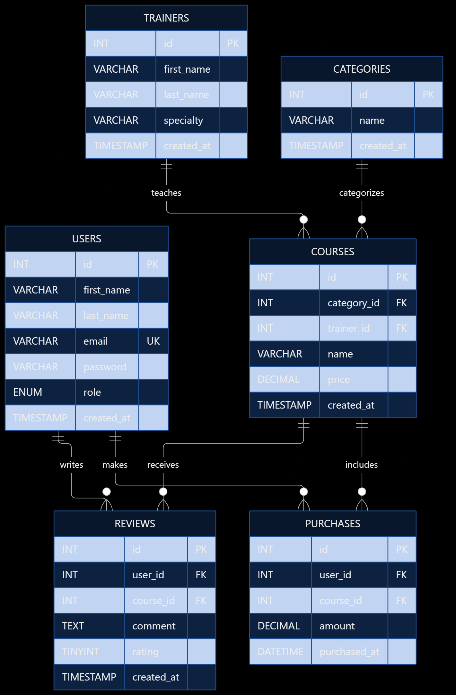

# Mentor

Mentor: Full-stack learning platform built as a Sigle Page Application. The platform provides regular users to browse courses, view trainers, read events, make course purchases and leave reviews. Administrators have access to a dedicated dashboard to manage users, courses, trainers, events and monitor websites.

Roles: admin, user. 

Entities: users, courses, categories, trainers, purchases, reviews.
 
## Technology stack
- Frontend: HTML, CSS, JavaScript, jQuery, Bootstrap 5, single-page application (SPA)
- Backend: PHP with FlightPHP (REST API), PDO, MySQL
- Local server: XAMPP
 
## Folder structure
- frontend/: css/, js/, views/ (one HTML file per view), assets/
- backend/: routes/, services/, dao/, middleware/, config/, logs/
- database/: Entity Relationship Diagram and .sql db file
- docs/: AI_LOG.md and other documentation

## Entity-Relationship Diagram



| Relationship | Description |
| :---: | :---: |
| Categories -> Courses | One category can contain multiple courses. |
| Trainers -> Courses | One trainer can teach multiple courses. |
| Users -> Reviews | One user can write multiple reviews. |
| Users -> Purchases | One user can make multiple purchases. |
| Courses -> Reviews | One course can receive multiple reviews. |
| Courses -> Purchases | One course can be purchased multiple times. |

## Running Locally
1. Place project folder into:
    
    - XAMPP: ```C:\xampp\htdocs\```

2. Import the ```.sql``` file:

    - Start your local server (Start Apache and MySQL in the XAMPP control panel).
    - Open your browser and go to ```http://localhost/phpmyadmin```
    - Click on the "Import" tab at the top.
    - Click "Choose File" and select ```mentorcourses.sql``` file.
    - Click "Import" (or "Go") at the bottom. You should see a green success message, and the ```mentorcourses``` database will appear in the left sidebar.

3. Create the Configuration File:

    - Create a file named ```config.php``` inside the ```config``` folder and add code from ```config.example.php```

4. Open the Project:

    - Open your web browser.
    - Navigate to project folder: ```http://localhost/Mentor/frontend```